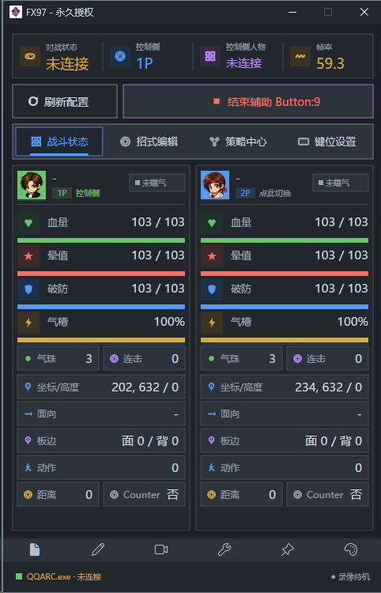
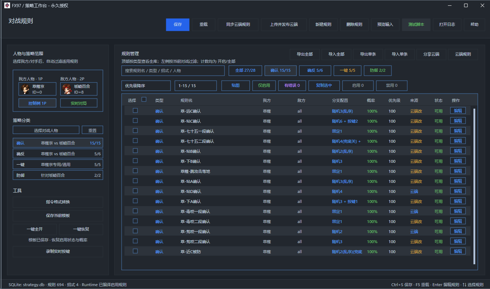
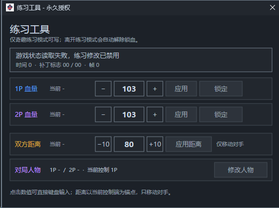
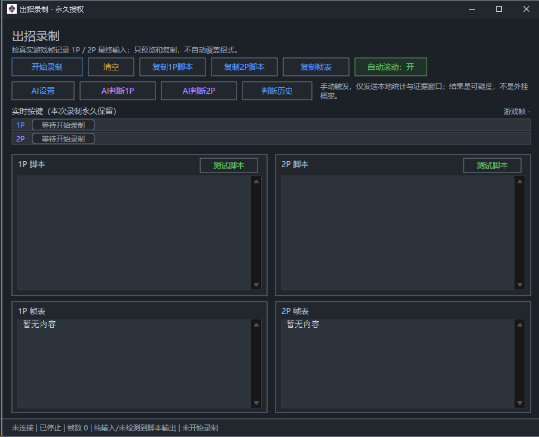
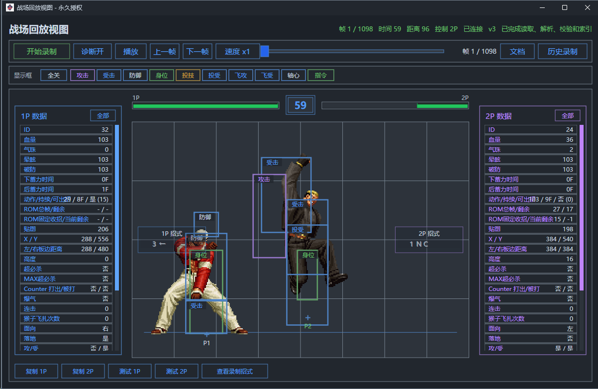
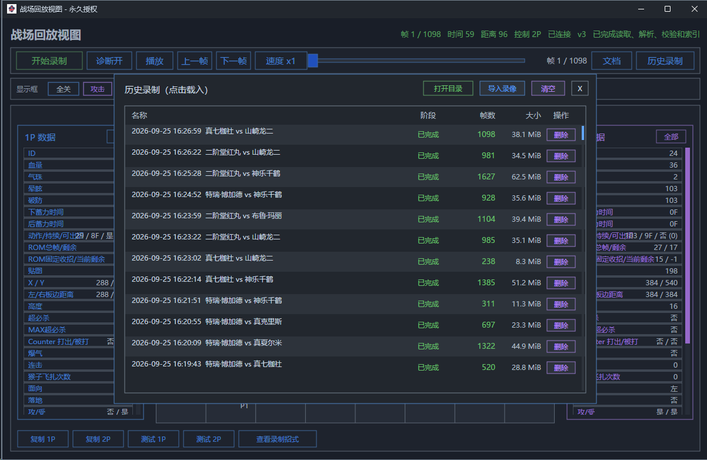
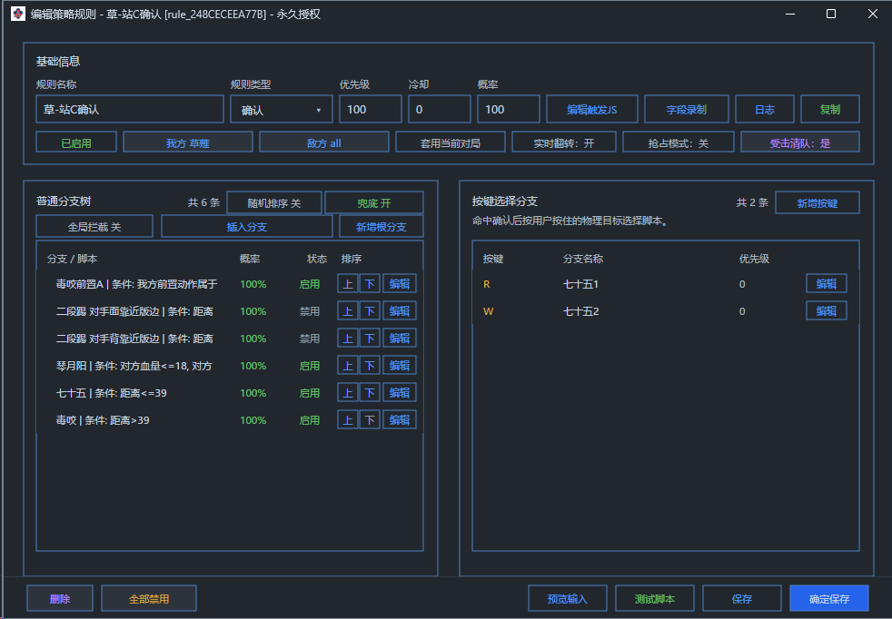
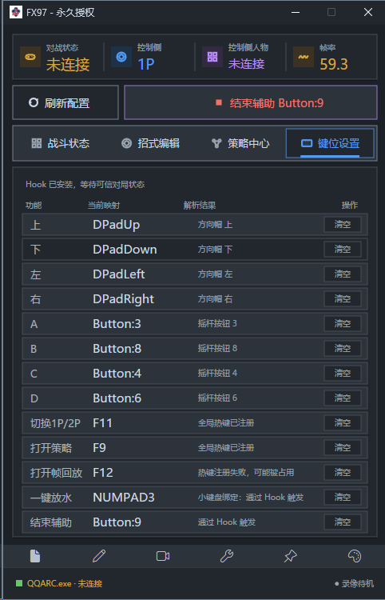

# FX97 — 拳皇 97 对战辅助
> 作者QQ:2517654835
## FX97 是面向《拳皇 97》玩家的 Windows 对战辅助工具。它读取当前对局状态，根据用户配置的规则判断时机，并通过输入 Hook 执行招式、确认、确反、防御和一键操作。

[GitHub 下载](https://github.com/ALittle-Cool/FX97/releases/latest) · [百度网盘下载](https://pan.baidu.com/s/1-2F1L5DMAgih16d_l0oSkQ?pwd=1gfp) · [问题反馈](https://github.com/ALittle-Cool/FX97/issues) · [交流讨论](https://github.com/ALittle-Cool/FX97/discussions)

> 当前版本：**1.0.0.443**  
> 本仓库用于公开介绍、下载和交流，不包含客户端或授权服务端源码。

## 奇趣拳皇战绩代刷

作者提供奇趣电竞拳皇战绩代刷服务，使用独立的“奇趣拳皇自动对战结算工具”批量处理。**该服务通过合成录像结算，不代表真实对打**；它与上方下载的 FX97 对战辅助是两个独立工具。

**支持的游戏**

- 《97原版》、97原版 1V1、97问号版、97风云再起、97屠蛇。
- 《98原版》、98原版 1V1。
- 《97 3V3组队》：每组可选择 3～6 个账号，每队 1～3 人。

**战绩与速度**

- 可指定对局数量、哪一方获胜，或设置随机胜负、胜率及双方各自的胜场数，用于调整胜场、负场和胜率。等级、经验等以服务器实际结算为准。
- 同一组可在同一房间连续结算，参考速度约 **1～3 秒/局**。实际速度受游戏模式、参赛人数、账号资格、网络和服务器响应影响，不保证固定耗时。
- 每局查询参赛账号的战绩；如果结果未确认，任务会暂停并提示核对，避免重复提交。

**账号条件与咨询**

- 参赛账号需要有可用流量、有效流量月卡或有效贵族资格；VIP 等级本身不等于有效贵族。部分账号可能有每日对局次数限制。
- 需要代刷可联系作者 QQ：**2517654835**，说明游戏版本、期望局数和胜负需求。请勿在公开 Issue 或讨论区发送账号密码。

## 免费天卡

- 使用 GitHub 登录，账号默认需要注册满 7 天。
- 必须已 Star 本仓库。
- 每个 GitHub 账号每天按北京时间可领取一次。
- 默认每次领取后有效 24 小时，固定使用同一张个人卡密。
- 卡密第一次登录客户端时绑定当前电脑。
- 如果领取后取消 Star，下次领取时天卡会被封禁，重新 Star 后仍需管理员手动解封。

[前往领取免费天卡](https://kof.xyner.cn/free-card)

## 主要功能

- 支持 QQARC、Fightcade FBNeo 和游聚。
- 支持 1P、2P 控制侧切换。
- 支持确认、确反、防御、一键等对战规则。
- 可按人物、对手、动作、距离、血量、能量和位置等条件选择分支。
- 可视化编辑招式输入、规则、分支和触发 JavaScript。
- 支持键盘、小键盘和摇杆按键映射。
- 提供运行日志、动作、贴图、输入和规则诊断。
- 支持对局回放录制、保存、加载和导入。
- 支持云端规则、招式、基址和平台配置。

## 界面预览

| 战斗状态 | 策略工作台 |
| --- | --- |
|  |  |

| 练习工具 | 出招录制 |
| --- | --- |
|  |  |

| 战场回放 | 历史录像 |
| --- | --- |
|  |  |

| 规则编辑器 | 键位设置 |
| --- | --- |
|  |  |

## 安装与启动

下载渠道：

- [GitHub Releases（推荐，可核对 SHA-256）](https://github.com/ALittle-Cool/FX97/releases/latest)
- [百度网盘（提取码：1gfp）](https://pan.baidu.com/s/1-2F1L5DMAgih16d_l0oSkQ?pwd=1gfp)

安装步骤：

1. 下载完整 ZIP；通过 GitHub 下载时可使用同版本 `.sha256` 文件核对完整性。
2. 将压缩包完整解压到新的空目录，不要覆盖混用旧版本文件。
3. 启动支持的游戏平台并进入《拳皇 97》游戏。
4. 右键 `Kof97AIAssistWin32.exe`，选择“以管理员身份运行”。
5. 输入卡密登录；程序会识别游戏平台并下载所需配置。
6. 登录后确认控制侧为 1P 或 2P，再启用需要的规则。

不要直接启动 `Kof97AIAssistClient.exe`，也不要单独移动 EXE、DLL 或 `data` 目录中的文件。

## 交流与反馈

- 使用问题、经验交流和玩法分享请前往 [Discussions](https://github.com/ALittle-Cool/FX97/discussions)。
- 确定可以复现的软件问题请提交 [Bug 反馈](https://github.com/ALittle-Cool/FX97/issues/new?template=bug.yml)。
- 新功能想法请提交 [功能建议](https://github.com/ALittle-Cool/FX97/issues/new?template=feature.yml)。
- 崩溃时请附上 `%LOCALAPPDATA%\FX97\diagnostics` 中最新的 `FX97诊断-*.zip`，提交前检查其中是否有不希望公开的信息。

## 安全与使用提示

- 本工具需要向目标游戏进程注入输入 Hook，部分安全软件可能报警；只从本仓库 Releases 下载。
- 不要从第三方获取所谓“破解版”、来历不明的卡密或替换 DLL。
- 不要在公开 Issue 中粘贴卡密、机器码、登录令牌或个人信息。
- 本工具不附带游戏本体、ROM、模拟器或任何游戏版权内容。
- 使用者应自行确认游戏平台规则，并承担使用辅助工具可能带来的账号风险。

常见问题见 [docs/FAQ.md](docs/FAQ.md)，安全问题请按 [SECURITY.md](SECURITY.md) 中的方式私下报告。
